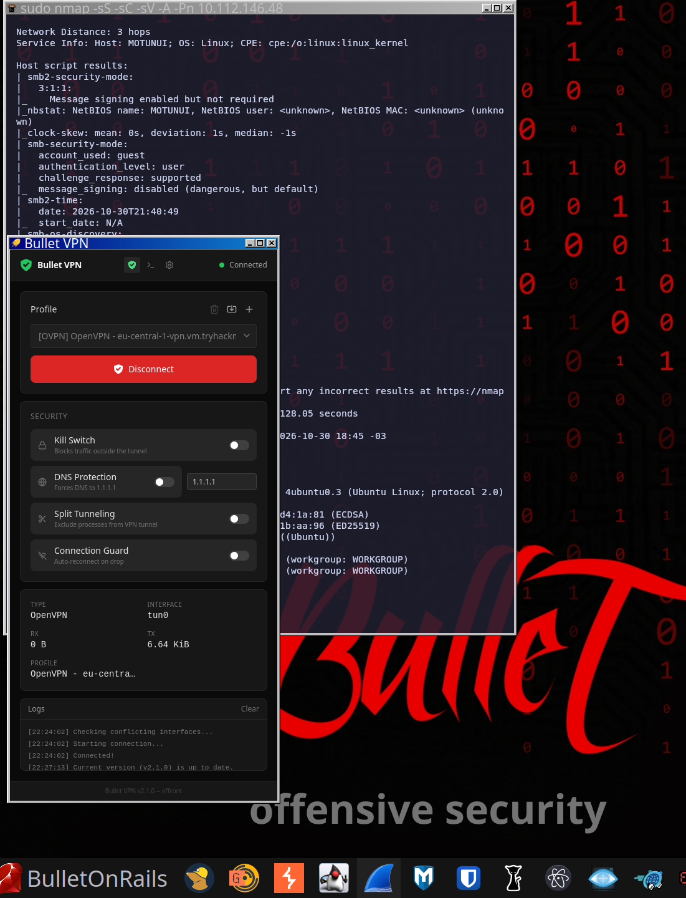
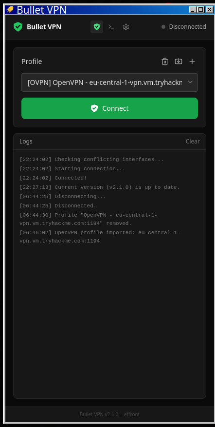
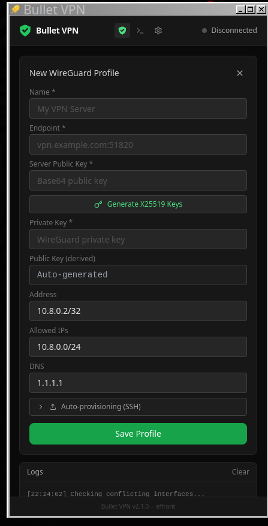
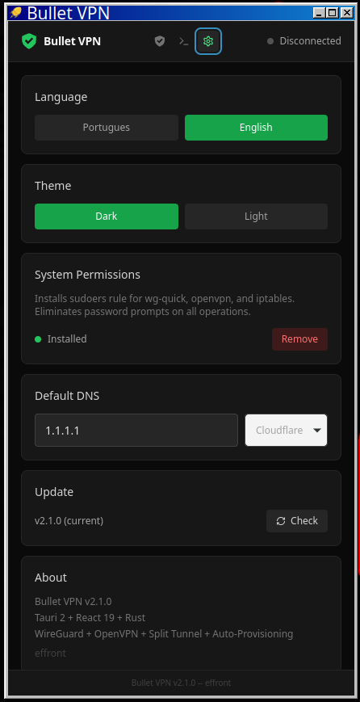

```
██████╗ ██╗   ██╗██╗     ██╗     ███████╗████████╗
██╔══██╗██║   ██║██║     ██║     ██╔════╝╚══██╔══╝
██████╔╝██║   ██║██║     ██║     █████╗     ██║
██╔══██╗██║   ██║██║     ██║     ██╔══╝     ██║
██████╔╝╚██████╔╝███████╗███████╗███████╗   ██║
╚═════╝  ╚═════╝ ╚══════╝╚══════╝╚══════╝   ╚═╝

      Self-hosted VPN Client — powered by @effront
```

<div align="center">

[](https://www.rust-lang.org/)
[](https://v2.tauri.app/)
[](https://react.dev/)
[](https://opensource.org/licenses/MIT)

</div>

---

```
+===========================================================================+
|  BULLET VPN -- Self-hosted WireGuard + OpenVPN Client                     |
+===========================================================================+
|  Desktop VPN client for your own infrastructure.                          |
|  WireGuard and OpenVPN profiles, SSH tunnel manager, kill switch,         |
|  DNS protection. Built with Tauri 2 (Rust + React). Zero logs.            |
+===========================================================================+
```

```
+---------------------------------------------------------------------------+
|  Sec: Chaves Curve25519 native  + iptables kill switch                    |
|  Performance: WireGuard kernel-level for max specified                    |
|  Protocol:  WireGuard + OpenVPN (dual stack complete)                     |
|  Beginner-friendly,: Clean Interface, 3 clicks to begin                   |
|  Zero Logs: No data saved or remotely sent                                |
|  Privacy:   DNS protection via DNAT, kill switch via iptables             |
|  Multiplataform:  Linux (ready), Windows e macOS (soon)                   |
|  SSH Tunnels: Port forwarding local/remote/SOCKS integrated               |
+---------------------------------------------------------------------------+
```

---

<details>
<summary><kbd>Features (click to expand)</kbd></summary>

```
+---------------------------------------------------------------------------+
|  CORE                                                                     |
|  [x] Profiles        -- multiple VPN connections, switch in one click     |
|  [x] WireGuard       -- wg-quick up/down, kernel-level tunnel             |
|  [x] OpenVPN         -- .ovpn import, daemon management via PID           |
|  [x] Status          -- real-time transfer RX/TX from /proc/net/dev       |
|  [x] Config store    -- profiles persisted in ~/.config/bullet-vpn/       |
|  [x] Import          -- paste .conf (WG) or .ovpn (OpenVPN) to import     |
|  [x] Conflict detect -- auto teardown conflicting WG interfaces           |
|  [x] Permissions     -- one-time sudoers install, no more password        |
|                                                                           |
|  SECURITY                                                                 |
|  [x] Kill switch     -- iptables OUTPUT chain blocking non-tunnel         |
|  [x] DNS protection  -- iptables DNAT forcing DNS through tunnel          |
|  [x] Route control   -- granular AllowedIPs per profile                   |
|  [x] Split tunneling -- per-app routing via cgroup (Linux)                |
|                                                                           |
|  SSH TUNNELS                                                              |
|  [x] Tunnel manager  -- local/remote/dynamic (SOCKS) port forwarding      |
|  [x] Tunnel profiles -- save frequent tunnels (e.g. "DBeaver:15432")      |
|  [x] Auto-reconnect  -- persistent tunnels that survive network changes   |
|                                                                           |
|  AUTO-PROVISIONING                                                        |
|  [x] SSH register    -- auto-register peer on remote server via SSH       |
|  [x] Server profiles -- associate SSH credentials to VPN profiles         |
|  [x] Firewall check  -- test UDP reachability before connecting           |
+---------------------------------------------------------------------------+
```

</details>

---

## Table of Contents

```
+------------------------------------------------------+
|  01 - Quick Start                                    |
|  02 - Technology Stack                               |
|  03 - Architecture                                   |
|  04 - Usage                                          |
|  05 - Security                                       |
|  06 - Server Setup                                   |
|  07 - Development                                    |
|  08 - Roadmap                                        |
|  09 - Ethical Use                                    |
+------------------------------------------------------+
```

---

## Preview

<div align="center">

| Connected | Disconnected |
|:---------:|:------------:|
|  |  |

| New Profile | Settings |
|:-----------:|:--------:|
|  |  |

</div>

---

## 01 - Quick Start

### Prerequisites

```
+---------------------------------------------------------------------------+
|  Linux    |  sudo apt install wireguard openvpn libwebkit2gtk-4.1-dev     |
|  Windows  |  WireGuard + OpenVPN + WebView2 Runtime                       |
|  macOS    |  brew install wireguard-tools openvpn                         |
+---------------------------------------------------------------------------+
```

### Run from source

```bash
git clone https://github.com/bulletdev/bullet-vpn.git
cd bullet-vpn
npm install
npx tauri dev
```

### Build release

```bash
npx tauri build
# Output: src-tauri/target/release/bundle/
#   Linux  -> .deb, .AppImage
#   Windows -> .exe, .msi
#   macOS  -> .dmg, .app
```

---

## 02 - Technology Stack

```
+======================+====================================================+
|  LAYER               |  TECHNOLOGY                                        |
+======================+====================================================+
|  Desktop             |  Tauri 2 (Rust backend + system WebView)           |
|  Frontend            |  React 19 + TypeScript + Tailwind CSS              |
|  VPN Tunnel          |  WireGuard (wg-quick) + OpenVPN (daemon)           |
|  Privilege           |  sudoers (NOPASSWD) / pkexec fallback              |
|  Firewall            |  iptables (kill switch + DNS DNAT)                 |
|  SSH Tunnels         |  ssh -L/-R/-D (background, PID tracked)            |
|  Persistence         |  SQLite + AES-256-GCM encrypted keys               |
|  Icons               |  Custom SVG (effront shield)                       |
|  Build               |  Vite 6 + Tauri bundler                            |
+======================+====================================================+
```

```
+======================+=============+==============+
|  METRIC              |  TAURI 2    |  ELECTRON    |
+======================+=============+==============+
|  Binary size         |  ~5 MB      |  ~150 MB     |
|  Memory usage        |  ~30 MB     |  ~150 MB+    |
|  Backend language    |  Rust       |  Node.js     |
|  Attack surface      |  Minimal    |  Full V8+Node|
|  Startup time        |  < 1s       |  2-3s        |
+======================+=============+==============+
```

---

## 03 - Architecture

```
+-------------------------------------------+
|              Tauri Window                 |
|  +-------------------------------------+  |
|  |    React Frontend (WebView)         |  |
|  |  - VPN profiles + connect UI        |  |
|  |  - SSH tunnel manager               |  |
|  |  - Security toggles (KS, DNS)       |  |
|  |  - Status dashboard + logs          |  |
|  |  - Settings (permissions, DNS)      |  |
|  +-------------------------------------+  |
|              |  Tauri IPC  |              |
|  +-------------------------------------+  |
|  |    Rust Backend (privileged)        |  |
|  |  - wireguard.rs   (wg-quick)        |  |
|  |  - openvpn.rs     (openvpn daemon)  |  |
|  |  - killswitch.rs  (iptables chain)  |  |
|  |  - dns.rs         (iptables DNAT)   |  |
|  |  - ssh.rs         (ssh -L/-R/-D)    |  |
|  |  - permissions.rs (sudoers mgmt)    |  |
|  |  - profiles.rs    (JSON CRUD)       |  |
|  +-------------------------------------+  |
+-------------------------------------------+
         |              |             |
    WireGuard       OpenVPN       SSH tunnel
    interface       tun0          (port fwd)
```

### Project Structure

```
Bullet-VPN/
  src/                      React frontend
    App.tsx                   Main UI (3 views: VPN, SSH, Settings)
    main.tsx                  Entry point
    index.css                 Tailwind base
  src-tauri/                Rust backend
    src/
      lib.rs                  Tauri commands + state management
      profiles.rs             VPN profile CRUD (WG + OVPN)
      wireguard.rs            wg-quick up/down, config writer, conflict detect
      openvpn.rs              openvpn daemon, PID tracking, .ovpn import
      killswitch.rs           iptables OUTPUT chain (BULLET_VPN_KS)
      dns.rs                  iptables nat DNAT for DNS protection
      ssh.rs                  SSH tunnel manager (local/remote/dynamic)
      db.rs                   SQLite persistence + AES-256-GCM encryption
      permissions.rs          sudoers install/uninstall for NOPASSWD
      split_tunnel.rs         cgroup net_cls per-PID routing
      connection_guard.rs     background monitor, auto-reconnect on drop
      provisioning.rs         SSH-based WireGuard peer registration
      main.rs                 Entry point
    Cargo.toml
    tauri.conf.json
  package.json
  vite.config.ts
  tailwind.config.js
```

---

## 04 - Usage

### Add a WireGuard profile

1. Open Bullet VPN
2. Click `+` (manual) or the import icon (paste .conf)
3. Fill in: name, endpoint, server public key, private key, allowed IPs
4. Click "Conectar"

### Add an OpenVPN profile

1. Click the import icon
2. Paste your .ovpn file content
3. Auto-detected as OpenVPN (looks for `client` + `dev tun` / `<ca>`)
4. Profile saved with endpoint extracted from `remote` directive

### Kill Switch

When connected, toggle "Kill Switch" in the security panel.
Blocks all outgoing traffic except through the VPN tunnel.
Auto-disabled on explicit disconnect.

```
iptables chain: BULLET_VPN_KS
  ACCEPT: loopback, VPN interface, VPN endpoint, LAN (RFC1918), DHCP
  REJECT: everything else (icmp-net-unreachable)
```

### DNS Protection

Toggle "DNS Protection" to force all DNS queries through a specified server.
Uses iptables DNAT to redirect port 53 traffic transparently.

```
iptables -t nat: DNAT all :53 -> <tunnel-dns>:53
```

### SSH Tunnels

Switch to the SSH tab. Add tunnel profiles:

```bash
# What Bullet VPN automates:
# Local:   ssh -L 15432:127.0.0.1:5432 -N user@host
# Remote:  ssh -R 8080:127.0.0.1:3000 -N user@host
# Dynamic: ssh -D 1080 -N user@host (SOCKS proxy)
```

### Permissions (no more password prompts)

Go to Settings, click "Instalar". One-time password prompt to write:

```
/etc/sudoers.d/bullet-vpn
  <user> ALL=(root) NOPASSWD: wg-quick, openvpn, ip, kill, killall, iptables
```

After install, all VPN operations run via `sudo` without prompts.

---

## 05 - Security

```
+---------------------------------------------------------------------------+
|  SECURITY MODEL                                                           |
+---------------------------------------------------------------------------+
|  Keys: Curve25519 (native WireGuard)                                      |
|  Protocols: WireGuard (audited) + OpenVPN (audited)                       |
|  DNS: Cloudflare (1.1.1.1), Quad9, Google, OpenDNS (configurable)         |
|  Kill Switch: iptables OUTPUT chain (REJECT, not DROP)                    |
|  DNS Protection: iptables NAT DNAT (transparent, no resolv.conf changes)  |
|  Logs: Local only (~/.config/bullet-vpn/), no data sent to servers        |
|  Configs: 0600 file permissions for .conf and .ovpn files                 |
|  Conflicts: Automatic detection and teardown of conflicting WG interfaces |
|  Privileges: sudoers NOPASSWD for specific commands only, never ALL       |
+---------------------------------------------------------------------------+
```

---

## 06 - Server Setup

### WireGuard server (Linux)

```bash
sudo apt install wireguard

wg genkey | tee /etc/wireguard/server.key | wg pubkey > /etc/wireguard/server.pub

# /etc/wireguard/wg0.conf
[Interface]
PrivateKey = <server private key>
Address = 10.8.0.1/24
ListenPort = 51820
PostUp = iptables -A FORWARD -i wg0 -j ACCEPT; iptables -t nat -A POSTROUTING -o eth0 -j MASQUERADE
PostDown = iptables -D FORWARD -i wg0 -j ACCEPT; iptables -t nat -D POSTROUTING -o eth0 -j MASQUERADE

[Peer]
PublicKey = <client public key>
AllowedIPs = 10.8.0.2/32

sudo wg-quick up wg0
sudo systemctl enable wg-quick@wg0
```

### OpenVPN server

Use your existing .ovpn config, or generate with easy-rsa:

```bash
sudo apt install openvpn easy-rsa
# Follow standard OpenVPN server setup
# Export client .ovpn and paste into Bullet VPN import
```

---

## 07 - Development

### Dev mode (hot reload)

```bash
npm install
npx tauri dev
```

### Build

```bash
npx tauri build          # release
npx tauri build --debug  # debug symbols
```

### Rust backend only

```bash
cd src-tauri
cargo check              # type check
cargo clippy             # lint
cargo test               # unit tests
```

### Frontend only

```bash
npm run dev              # Vite dev server at :1420
npm run build            # production build to dist/
```

---

## 08 - Roadmap

```
+=======+==========================================+==========+
| PHASE |  SCOPE                                   |  STATUS  |
+=======+==========================================+==========+
|   1   |  MVP: profiles, WG connect, status       |  DONE    |
|   2   |  OpenVPN, .ovpn import, dual protocol    |  DONE    |
|   3   |  Kill switch, DNS protection             |  DONE    |
|   4   |  SSH tunnel manager                      |  DONE    |
|   5   |  Permissions (sudoers), settings panel   |  DONE    |
|   6   |  Split tunneling (cgroup routing)        |  DONE    |
|   7   |  Auto-provisioning via SSH               |  DONE    |
|   8   |  Auto-reconnect, connection guard        |  DONE    |
|   9   |  Theme, i18n, update check, packaging     |  DONE    |
+=======+==========================================+==========+
```

---

## 09 - Ethical Use

```
+---------------------------------------------------------------------------+
|  Bullet VPN is a tool for managing your own VPN infrastructure.           |
|  It does NOT provide anonymity services or relay traffic through          |
|  third-party servers. You are responsible for your own server and         |
|  compliance with local laws regarding VPN usage.                          |
|                                                                           |
|  Intended use cases:                                                      |
|  - Accessing your own private infrastructure (VPS, homelab)               |
|  - Authorized security testing with proper scope                          |
|  - Corporate remote access to internal services                           |
|  - Privacy on untrusted networks                                          |
+---------------------------------------------------------------------------+
```

---

## License

MIT License -- see [LICENSE](LICENSE) for details.

---

<div align="center">

```
Built by effront
```

</div>
